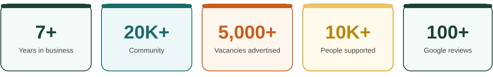

  

<h1 align="center">Hi, I'm Prudent 👋</h1>

  <b>Founder · Recruiter · Career Coach · AI-Powered Builder · Certified ScrumMaster</b> 
  🇬🇧 United Kingdom &nbsp;·&nbsp; Serving UK and Nigerian job markets

  
  
  
  
  

## ✨ About Me

I help people **get hired**, and I help employers **hire well**.

I run **Job Hunt with Prudyice**, a recruitment and career services brand operating since 2019, connecting job seekers and employers across the UK and Nigeria, with a strong focus on NHS, care sector and corporate roles.

I'm also a hands-on builder. I use **AI as a creative and technical partner** to design and run my business: the website, the trackers, the documents, the content and the client workflows. I'm now building a job seeker app and learning to code along the way.

## 💼 What I Do

<table>
  <tr>
    <td width="33%" valign="top">
      <h3>📄 CV Writing</h3>
      ATS-optimised, single-column CVs tailored to the role.
    </td>
    <td width="33%" valign="top">
      <h3>✍️ Personal Statements</h3>
      NHS, Civil Service and corporate applications.
    </td>
    <td width="33%" valign="top">
      <h3>🎤 Interview Prep</h3>
      One-to-one coaching and practical guides.
    </td>
  </tr>
  <tr>
    <td valign="top">
      <h3>🧭 Career Coaching</h3>
      Career Pathway Programme and job search strategy.
    </td>
    <td valign="top">
      <h3>🤝 Recruitment</h3>
      Job adverts, candidate sourcing, outsourcing and executive recruitment.
    </td>
    <td valign="top">
      <h3>🌍 International</h3>
      Placing Nigerian and African remote professionals with overseas employers.
    </td>
  </tr>
</table>

## 🤖 AI & Creative Work

I turn ideas into finished, working things using AI, and I'm creative about how I do it.

- 🌐 **Designed and launched my own website** on GitHub Pages with a custom domain, built through AI-assisted development
- 🎨 **Created a full brand system**: logo recreation, colour palette, hiring-ad templates, Instagram reel covers, invoices, receipts and email signatures
- 🎬 **Produce educational videos** using AI text-to-speech character voices, built around a hook, a call to action and a takeaway
- 📊 **Built tracking systems** for recruitment pipeline, ATS scoring, placements and revenue, with dashboards and formulas
- ⚙️ **Automate document production** with Node.js and Python for polished CVs, PDFs and agreements
- 🧠 **Design prompts and workflows** that turn one client message into an advert, caption, invoice and receipt
- 🔍 **Use AI for research and outreach**, from finding target companies to drafting partnership proposals

## 🛠️ What I've Built

| Project | Status |
|---|---|
| 🌐 Business website on GitHub Pages | ✅ Live |
| 📊 Applicant recruitment & placement tracking system | ✅ Built |
| ✅ CV scoring & ATS tracking workflow | ✅ Built |
| 💰 Placement & revenue tracker | ✅ Built |
| ⚙️ Repeatable client workflow (ad, caption, invoice, receipt) | ✅ In use |
| 🗂️ Branded document system (CVs, brochures, agreements, terms of business) | ✅ In use |
| 📱 Job seeker app for the Nigerian market | 🔨 In progress |
| 🌍 International recruitment service | 🔨 In progress |

<!--
## 🖼️ Samples of My Work

Upload your images to this repository, then remove the arrows around this block.

  

| Hiring Ad | Website | Instagram Reel Cover |
|---|---|---|
|  |  |  |
-->

## 🎓 Credentials

- 🎓 **BA (Hons) Business Management, First Class**, University of Sunderland (2024)
- 🏅 **Certified ScrumMaster (CSM)**, 2023
- 📋 Specialist knowledge of UK application systems: **TRAC**, **NHS values framework**, **Civil Service behaviours**, **STAR method**, **ATS optimisation**

## 🧰 Skills & Tools

**Recruitment & Careers**
`CV Writing` `Personal Statements` `Interview Coaching` `ATS Optimisation` `Candidate Sourcing` `Employer Relations` `STAR Method`

**Project & Delivery**
`Agile` `Scrum` `Sprint Planning` `RAID Logs` `Stakeholder Management` `Process Improvement`

**AI & Technical**

  
  
  
  
  
  
  
  
  

## ⭐ What People Say

Real feedback from job seekers and employers is on my **[Google Reviews page](https://maps.app.goo.gl/gV7G4y7g9vFd1WA69)**. I reply to every one.

🏆 Featured in Lagos Metropolitan's *Top Recruitment Agencies in Lagos (2026)*

## 🧱 Background

- **Job Hunt with Prudyice**: Founder, operating since 2019
- **NIDCOM Solutions (BankLingo)**: Contract staff. Led sprint planning, allocated tasks, managed the delivery team and kept the RAID log. Introduced Agile, replacing waterfall
- **Tyne Corp**: Volunteer with a training provider

## 🌱 Currently

- 🔨 Building the Job Hunt job seeker app
- 🌍 Growing international recruitment and a UK employer placement service
- 💻 Learning to code, one project at a time

## 🤝 Let's Work Together

- 🧑‍💼 **Employers:** need to hire reliable people? Let's talk.
- 🎯 **Job seekers:** CV, personal statement or interview support. We never charge job seekers to be put forward for roles.
- 🌍 **Partners:** open to partnerships in recruitment and remote talent placement.

📧 **talent@jobhuntwithprudyiceltd.com**
🌐 **[jobhuntwithprudyiceltd.com](https://jobhuntwithprudyiceltd.com)**

<i>Helping people get hired, and helping businesses hire smart.</i>

